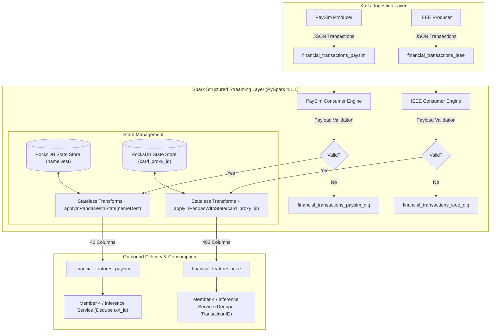

# Member 3: Real-Time Streaming Feature Store (PaySim & IEEE-CIS)

Production-grade PySpark Structured Streaming engines and Kafka streaming pipelines for real-time transaction feature engineering on both the PaySim and IEEE-CIS datasets.

---

## 1. Architecture Diagram



---

## 2. Topic Topology & Contracts Table

| Dataset | Inbound Input Topic | Outbound Feature Topic | Dead Letter Queue (DLQ) | State Key | Column Count | Deduplication Key | Contract File |
|---|---|---|---|---|---|---|---|
| **PaySim** | `financial_transactions_paysim` | `financial_features_paysim` | `financial_transactions_paysim_dlq` | `nameDest` | 42 | `txn_id` (SHA-256 string) | [`MEMBER3_OUTPUT_CONTRACT.md`](MEMBER3_OUTPUT_CONTRACT.md) |
| **IEEE-CIS** | `financial_transactions_ieee` | `financial_features_ieee` | `financial_transactions_ieee_dlq` | `card_proxy_id` | 483 | `TransactionID` (int) | [`MEMBER3_IEEE_OUTPUT_CONTRACT.md`](MEMBER3_IEEE_OUTPUT_CONTRACT.md) |

### State Store Provider
Both pipelines utilize `org.apache.spark.sql.execution.streaming.state.RocksDBStateStoreProvider` (format version 5). RocksDB offloads state to local disk / SST files, supporting high-cardinality keys (2.7M+ destinations in PaySim, millions of card proxies in IEEE) without JVM heap exhaustion.

---

## 3. Prerequisites & Environment

1. **Operating System**: Windows 10/11 or Linux / macOS.
2. **Docker Desktop**: Running local Kafka broker via Docker.
   - Recommended image: `apache/kafka:3.9.0` (KRaft mode).
   - Kafka bootstrap server: `127.0.0.1:9092`.
3. **Java Runtime**: Eclipse Adoptium JDK 17 (Java 17 LTS).
4. **Python**: Python 3.12 (virtual environment with project dependencies).
5. **PySpark**: Version 4.1.1 (Kafka connector package: `org.apache.spark:spark-sql-kafka-0-10_2.13:4.1.1`).
6. **Windows Hadoop Native Libraries**:
   - On Windows, PySpark requires Hadoop binaries.
   - Set environment variable: `HADOOP_HOME=C:\hadoop`.
   - Ensure `C:\hadoop\bin\hadoop.dll` and `C:\hadoop\bin\winutils.exe` are present.
   - Both consumers automatically invoke `System.load(r"C:\hadoop\bin\hadoop.dll")` on initialization if detected.

---

## 4. Execution & Startup Guide

### 4.1 Start Kafka (Docker KRaft)
```bash
docker run -d --name kafka -p 9092:9092 -e KAFKA_NODE_ID=1 -e KAFKA_PROCESS_ROLES=broker,controller -e KAFKA_LISTENERS=PLAINTEXT://0.0.0.0:9092,CONTROLLER://0.0.0.0:9093 -e KAFKA_ADVERTISED_LISTENERS=PLAINTEXT://127.0.0.1:9092 -e KAFKA_CONTROLLER_LISTENER_NAMES=CONTROLLER -e KAFKA_LISTENER_SECURITY_PROTOCOL_MAP=CONTROLLER:PLAINTEXT,PLAINTEXT:PLAINTEXT -e KAFKA_CONTROLLER_QUORUM_VOTERS=1@localhost:9093 -e KAFKA_OFFSETS_TOPIC_REPLICATION_FACTOR=1 -e KAFKA_TRANSACTION_STATE_LOG_REPLICATION_FACTOR=1 -e KAFKA_TRANSACTION_STATE_LOG_MIN_ISR=1 -e KAFKA_GROUP_INITIAL_REBALANCE_DELAY_MS=0 -e KAFKA_NUM_PARTITIONS=1 apache/kafka:3.9.0
```

### 4.2 Standard Topic Creation / Reset
```bash
# PaySim topics
docker exec kafka /opt/kafka/bin/kafka-topics.sh --bootstrap-server localhost:9092 --delete --topic financial_transactions_paysim,financial_features_paysim,financial_transactions_paysim_dlq --if-exists
docker exec kafka /opt/kafka/bin/kafka-topics.sh --bootstrap-server localhost:9092 --create --topic financial_transactions_paysim --partitions 1 --replication-factor 1
docker exec kafka /opt/kafka/bin/kafka-topics.sh --bootstrap-server localhost:9092 --create --topic financial_features_paysim --partitions 1 --replication-factor 1
docker exec kafka /opt/kafka/bin/kafka-topics.sh --bootstrap-server localhost:9092 --create --topic financial_transactions_paysim_dlq --partitions 1 --replication-factor 1

# IEEE-CIS topics
docker exec kafka /opt/kafka/bin/kafka-topics.sh --bootstrap-server localhost:9092 --delete --topic financial_transactions_ieee,financial_features_ieee,financial_transactions_ieee_dlq --if-exists
docker exec kafka /opt/kafka/bin/kafka-topics.sh --bootstrap-server localhost:9092 --create --topic financial_transactions_ieee --partitions 1 --replication-factor 1
docker exec kafka /opt/kafka/bin/kafka-topics.sh --bootstrap-server localhost:9092 --create --topic financial_features_ieee --partitions 1 --replication-factor 1
docker exec kafka /opt/kafka/bin/kafka-topics.sh --bootstrap-server localhost:9092 --create --topic financial_transactions_ieee_dlq --partitions 1 --replication-factor 1
```

### 4.3 Run Producers
```bash
# PaySim Producer (streams raw transactions sorted by step)
python member3_streaming/producer_paysim.py --limit 20000 --delay 0

# IEEE-CIS Producer (streams raw transactions sorted stably by TransactionDT, TransactionID)
python member3_streaming/producer_ieee.py --limit 20000 --delay 0
```

### 4.4 Run Consumers
```bash
# PaySim Streaming Consumer (writes 42 columns to financial_features_paysim)
python -m member3_streaming.consumer_paysim --bootstrap-servers localhost:9092

# IEEE-CIS Streaming Consumer (writes 483 columns to financial_features_ieee)
python -m member3_streaming.consumer_ieee --bootstrap-servers localhost:9092
```

### 4.5 Run Test Suite
```bash
# Fast unit & contract drift tests
pytest member3_streaming/tests/test_contract.py member3_streaming/tests/test_ieee_contract.py member3_streaming/tests/test_fast_unit.py -v

# Full automated test suite (includes slow real-streaming tests)
pytest member3_streaming/tests/ -v --durations=0
```

---

## 5. Dead Letter Queue (DLQ) & Guards

Malformed, invalid, or out-of-order events are routed to the respective DLQ topic without stopping active streaming queries:
```json
{
  "raw_value": "<serialized JSON payload>",
  "reason_code": "<REASON_CODE>",
  "ingested_at": "<ISO-8601 UTC timestamp>"
}
```

### Reason Codes
- **PaySim (9 codes)**: `MALFORMED_JSON`, `MISSING_FIELD`, `BAD_STEP_TYPE`, `BAD_TYPE`, `BAD_FIELD_TYPE`, `NEGATIVE_AMOUNT`, `INVALID_STEP`, `INVALID_LABEL`, `LATE_EVENT`.
- **IEEE-CIS (6 codes)**: `MALFORMED_JSON`, `MISSING_FIELD`, `BAD_FIELD_TYPE`, `NEGATIVE_AMOUNT`, `INVALID_LABEL`, `INVALID_TRANSACTIONDT`, `LATE_EVENT`.

**Payload behavior**: For validation errors, `raw_value` contains the raw unmodified Kafka input string. For `LATE_EVENT`, `raw_value` contains the enriched row serialized at state-evaluation time.

---

## 6. Fault Tolerance & Recovery Procedure

- Both pipelines provide **at-least-once** delivery guarantees.
- In crash tests involving hard kills (`taskkill /F /T`) mid-batch:
  - RocksDB restores state store checkpoints exactly up to the last committed batch.
  - Spark 4.1.1 exhibits a `KafkaMicroBatchStream.metrics` NullPointerException when replaying an uncommitted batch of stateful queries, with provider independence shown (RocksDB and HDFS), upstream ticket not verified.

### 6.1 IEEE Stateful Crash Recovery (Restart-Twice, No File Edits)
- After a hard crash mid-batch, restart the consumer; the first restart completes the interrupted batch and then exits non-zero with the Spark 4.1.1 `KafkaMicroBatchStream.metrics` NPE; restart it again and it continues normally. No file edits.
- **Evidence:** `reports/raw/PDG_restart_twice.txt` (IEEE stateful, one run, kill at 2,123, 412 byte-identical duplicates, 0 missing, 0 stateful mismatches).
- **Supervisor Requirement:** Unattended recovery requires a supervisor that restarts the process on a non-zero exit; this was not built or tested.
- **Scope & Limitations:** Verified on IEEE stateful only, one run; PaySim restart-twice is UNTESTED (contract still documents the PaySim operator workaround). Duplicates up to the in-flight batch size are expected; downstream consumers must deduplicate on `TransactionID` (IEEE) or `txn_id` (PaySim).
- **Legacy procedure (not needed for IEEE):** The previous manual operator rollback procedure (stopping consumer, deleting uncommitted `offsets/N` and `offsets/.N.crc`) is not needed. Note that deleting committed files is unsafe; **never delete `commits/`**.

### 6.2 PaySim Crash Recovery (Documented Operator Workaround)
- **OPERATOR WORKAROUND (Documented Rollback Procedure for PaySim)**:
  1. Terminate running consumer (`taskkill /F /T` or `kill -9`).
  2. Inspect checkpoint directory `offsets/` vs `commits/`.
  3. Identify uncommitted orphan offset index $N$ where `offsets/N` exists but `commits/N` does NOT exist.
  4. Delete ONLY `offsets/N` and `offsets/.N.crc`. **Never delete committed batch files (`commits/`)**.
  5. Restart consumer stream. Spark plans batch $N$ cleanly from committed offset $N-1$, restoring complete state continuity with byte-identical duplicate output.
  6. Downstream consumers deduplicate records on `txn_id`.

---

## 7. Known Limitations (Honest List)

1. **Micro-Batch Reordering**: Events arriving within a single micro-batch are sorted ascending by timestamp/step inside the state function, meaning intra-batch out-of-order events are absorbed and reordered, not rejected as `LATE_EVENT`.
2. **Spark 4.1.1 Mid-Batch Replay Crash**: Hard-killing a stateful consumer mid-batch leaves an uncommitted offset file that triggers a `KafkaMicroBatchStream.metrics` NPE on unassisted single restart; on IEEE stateful, restart-twice recovers with no file edits (unattended recovery requires a process supervisor; PaySim restart-twice is untested, operator rollback documented).
3. **Windows Test Suite Flakiness**: Fast tests pass reliably. The streaming tests pass when run alone, but runs on Windows are flaky (BlockManager NPE or timeouts, cause unverified). Observed fresh-clone results: continuous runs 6 failed/19 passed and 1 failed/24 passed; isolated run with 60 s cooldown 2 failed/23 passed; working copy continuous 25 passed (once). The failing test differs between runs. `test_real_streaming_late_event_routing` failed in 3 of 4 fresh-clone runs; cause unverified (possibly test timing).
4. **Member 4 Sink Status**: Member 4 integration is fully drafted with downstream deduplication examples (`example_consumer_member4.py`), but downstream team confirmation of final production sinks remains unanswered as of 2026-10-17.

---

## 8. Directory Layout

```text
member3_streaming/
├── consumer_paysim.py                 # PaySim Spark Structured Streaming consumer
├── consumer_ieee.py                   # IEEE-CIS Spark Structured Streaming consumer
├── producer_paysim.py                 # PaySim streaming Kafka producer
├── producer_ieee.py                   # IEEE-CIS streaming Kafka producer
├── ieee_raw_schema.py                 # Raw input schema for IEEE-CIS
├── ieee_output_schema.py              # Enriched 483-column output schema for IEEE-CIS
├── MEMBER3_OUTPUT_CONTRACT.md         # 42-column PaySim output contract
├── MEMBER3_IEEE_OUTPUT_CONTRACT.md    # 483-column IEEE-CIS output contract
├── example_consumer_member4.py        # Reference downstream deduplicating consumer
├── HANDOFF_MEMBER4.md                 # Member 4 inference integration specification
├── DECISIONS.md                       # Architectural decisions log
├── PROGRESS.md                        # Phase completion ledger
├── README.md                          # This documentation file
├── reports/                           # Phase reports and final delivery summaries
│   ├── PA_report.md                   # Phase A report (C07 & C08 repairs)
│   ├── PB_report.md                   # Phase B report (C10 contract & doc corrections)
│   ├── PC_report.md                   # Phase C report (C11 IEEE tests & crash recovery)
│   ├── PD_report.md                   # Phase D report (C12 final verification & delivery)
│   ├── FINAL_SUMMARY.md               # End-of-project roadmap cross-check summary
│   └── raw/                           # Untruncated raw execution logs
└── tests/                             # Automated test suite (25 tests)
    ├── test_contract.py               # PaySim contract & schema drift tests
    ├── test_ieee_contract.py          # IEEE contract & schema drift tests
    ├── test_fast_unit.py              # Unit tests for DLQ codes & Kafka connectivity
    ├── test_real_streaming.py         # PaySim streaming integration & recovery tests
    └── test_ieee_streaming.py         # IEEE streaming integration & recovery tests
```
